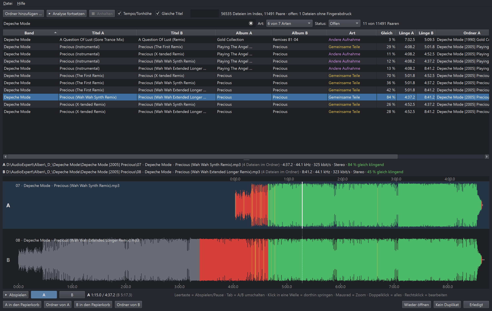

# FlacDup

Findet doppelte Musik in ganzen Musikordnern – am **Klang**, nicht an Dateinamen oder Tags.
Erkannt werden nicht nur identische Dateien in anderer Kodierung oder Bitrate, sondern auch
Ausschnitte (Radio-Edit, gekürzte Fassung), Remixe und Extended-Versionen mit gemeinsamen Teilen,
schneller oder langsamer abgespielte und in der Tonhöhe verschobene Fassungen sowie andere
Aufnahmen desselben Songs.

Jedes gefundene Paar zeigt **beide Wellenformen** untereinander, gemeinsame Stellen übereinander:
**grün** klingt gleich, **rot** verschieden, grau gibt es in der anderen Datei nicht. Beim Abhören
schaltet **Tab** millisekundengenau zwischen A und B um – an der passenden Stelle der anderen Datei,
sodass es wie ein durchgehender Track klingt.



## Installation (Windows)

Den aktuellen Installer **`FlacDup-<Version>-Setup.exe`** unter
[Releases](https://github.com/Yakobo1970/FlacDup/releases) herunterladen und starten. Er installiert
pro Benutzer (keine Admin-Rechte nötig) und bringt alles mit – Python, Qt, FFmpeg, libsndfile und
PortAudio müssen nicht separat installiert werden. Die Datenbank liegt in `%LOCALAPPDATA%\FlacDup`
und bleibt beim Deinstallieren erhalten.

Weil der Installer nicht signiert ist, zeigt Windows SmartScreen beim ersten Start eventuell eine
Warnung („Weitere Informationen“ → „Trotzdem ausführen“).

## Bedienung

1. **Ordner hinzufügen …** (oder Ordner ins Fenster ziehen). Ordner addieren sich; bereits
   analysierte, unveränderte Dateien werden übersprungen.
2. Die Analyse läuft in drei Phasen. Jedes Ergebnis wird sofort gespeichert – nach einem Abbruch
   oder Absturz macht **Analyse fortsetzen** an derselben Stelle weiter. Funde aus Phase 2 und 3
   erscheinen schon während der Analyse in der Liste.
3. Paar in der Liste wählen, abspielen (**Leertaste**) und mit **Tab** (oder **A**/**B**) umschalten.
4. Überflüssige Datei in den Papierkorb legen, oder das Paar als **Kein Duplikat** (**N**) bzw.
   **Erledigt** (**E**) markieren – markierte Paare tauchen nicht wieder auf.

Die Liste lässt sich nach Band, Titel, Album, Art, Übereinstimmung, Länge und Ordner sortieren und
nach Art, Prüfstand und Suchtext filtern. Die Dateiinfo zeigt Pfad, Anzahl der Dateien im Ordner,
Länge, Abtastrate, Bitrate, Packrate (bei verlustfreien Formaten) und den gleich klingenden Anteil.

**Bearbeiten:** Rechtsklick in eine Welle öffnet den Editor für diese Datei: Anfang/Ende kürzen,
Bereiche entfernen, in mehrere Teile zerlegen, Tags und Dateinamen ändern. MP3 wird ohne Neukodierung
geschnitten (Frame-genau, ~26 ms), FLAC/WAV/AIFF sample-genau und verlustfrei. Die abweichenden
Stellen aus dem Vergleich sind oben rot markiert. Neue Dateien werden als ungeprüft eingetragen und
beim nächsten „Analyse fortsetzen“ neu analysiert; das Original wandert als »(Original) Name« in den
Papierkorb (oder bleibt auf Wunsch so benannt im Ordner).

**Verschobene Dateien** werden an Name und Spieldauer wiedererkannt und behalten Fingerabdruck und
Prüfstand. **Datei → Nicht lesbare Dateien …** listet Dateien, die sich nicht einlesen ließen, mit
Sprung in den Explorer. Mehrere Archive lassen sich in getrennten Datenbanken führen (Menü Datei).

## Die drei Phasen

| Phase | Was passiert |
|---|---|
| 1 Index | je Datei ein Klang-Fingerabdruck aus markanten Spektralspitzen (11 kHz, logarithmische Frequenzachse) |
| 2 Abgleich | Dreiecks-Schlüssel aus je drei Spitzen, Abstimmung über den Zeitversatz – findet gemeinsame Musik an beliebiger Stelle; auf Wunsch auch Tempo/Tonhöhe ±10 % (23 Varianten) |
| 3 Feinvergleich | jedes Paar Sekunde für Sekunde (Bandkorrelation ohne Klangfarbe des Stücks), liefert Rot/Grün, Übereinstimmung, Art und die Zeitzuordnung fürs A/B-Umschalten; auf Wunsch zusätzlich Dateien gleicher Band mit gleichem Titel |

## Arten

| Art | Bedeutung |
|---|---|
| Identisch | dieselbe Aufnahme, fast vollständig in beiden Dateien |
| Ausschnitt | eine Datei steckt (fast) komplett in der anderen – Radio-Edit, gekürzte Fassung |
| Tempo/Tonhöhe | dieselbe Aufnahme schneller/langsamer oder in anderer Tonhöhe |
| Gemeinsame Teile | Remix, Extended Mix, Medley |
| Andere Aufnahme | gleicher Song, aber live, neu eingespielt oder in anderer Sprache |
| Schwach | nur kurze oder überlagerte Gemeinsamkeiten – meist kein Duplikat (standardmäßig ausgeblendet) |

Gemessene Übereinstimmung je Sekunde (1 = gleich): dieselbe Aufnahme 0,90–0,98, andere Aufnahme
desselben Songs 0,70–0,85, verschiedene Songs unter 0,45. Ab 0,85 wird eine Stelle grün.

**Tipp:** Für den ersten Lauf „Tempo/Tonhöhe“ ausschalten – dann stehen die klaren Dubletten schnell
bereit. Später einschalten und „Analyse fortsetzen“: Es werden nur noch die Varianten nachgesucht.

## Aus dem Quellcode starten

```
FlacDup.bat
```

Benötigt die Conda-Umgebung `flacdup` (Python 3.11, siehe `requirements.txt`):

```
conda create -n flacdup -c conda-forge --override-channels python=3.11
%USERPROFILE%\anaconda3\envs\flacdup\python.exe -m pip install -r requirements.txt
```

## Installer bauen

```
%USERPROFILE%\anaconda3\envs\flacdup\python.exe -m pip install pyinstaller
%USERPROFILE%\anaconda3\envs\flacdup\python.exe -m PyInstaller --noconfirm FlacDup.spec
copy LICENSE dist\FlacDup\ & copy THIRD_PARTY_NOTICES.md dist\FlacDup\
"C:\Program Files\Inno Setup 7\ISCC.exe" installer\FlacDup.iss
```

Ergebnis: `dist_installer\FlacDup-<Version>-Setup.exe`. Prüfen lässt sich die gebaute Anwendung mit
`dist\FlacDup\FlacDup.exe --selftest <Audiodatei> <ausgabe.txt>` (Bibliotheken, Fingerabdruck und
Feinvergleich im Worker-Prozess, Tags, deutsche Qt-Texte, Hauptfenster mit eigener Test-Datenbank).

## Tests

```
python tests/cli_run.py <test.db> [--var] <Ordner …>   # alle drei Phasen ohne GUI
python tests/gui_smoke.py <test.db> <Ausgabeordner> [Suche]
```

## Lizenz

Eigener Code: MIT (siehe `LICENSE`). Der Installer enthält Bibliotheken unter LGPL/GPL und anderen
Lizenzen, siehe `THIRD_PARTY_NOTICES.md`.

Idee, Konzept und Regie: Kay 'Yakobo' Fiedler · https://www.undabtanzbar.de ·
Spenden: https://paypal.me/yakobo
